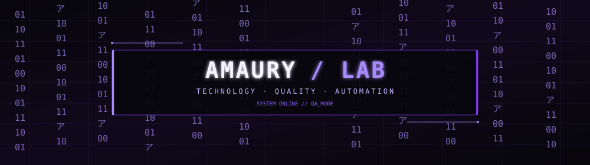
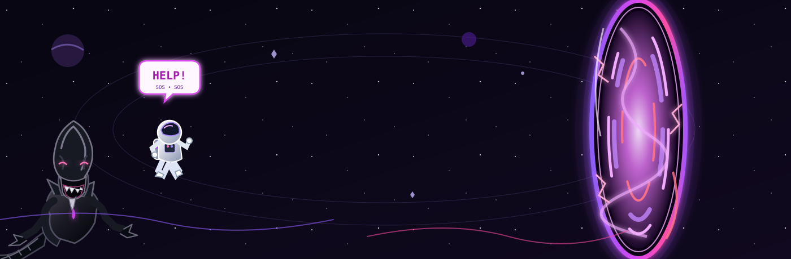

 

**IT Support · Software Quality · Test Automation**

*Building reliable systems. Testing beyond the obvious.*

 

---

## `01` / About me

I'm an IT professional with a background in **infrastructure, technical support, and software development**, currently expanding my knowledge of **Software Quality Assurance (QA)** and test automation.

My approach is simple: investigate the problem, understand the behavior, test the solution, and improve the result.

- 🎓 Systems Analysis and Development — FAMETRO
- 🖥️ IT Support and infrastructure
- 🧪 Software testing and quality assurance
- 📚 Postgraduate studies in Software Quality and Software Testing

---

## `02` / Focus areas

<table>
<tr>
<td width="33%" valign="top">

### ◈ IT Support

- Troubleshooting
- Hardware and software
- Users and permissions
- Network fundamentals

</td>
<td width="33%" valign="top">

### ◈ Quality Assurance

- Manual testing
- Test cases and scenarios
- Bug reporting
- Gherkin / BDD

</td>
<td width="33%" valign="top">

### ◈ Automation

- Cypress
- Selenium
- Python
- API testing

</td>
</tr>
</table>

---

## `03` / Tech stack

**Languages & Web**

  

**Testing & Automation**

  

**Tools & Database**

---

## `04` / Currently learning

- Software Quality and Software Testing
- Cypress and Selenium automation
- API testing with Postman
- Test documentation and bug reporting
- CI/CD fundamentals

---

### Let's build something reliable.

 

 

  

---

  

 

  

AMAURY / LAB — Technology with purpose.

